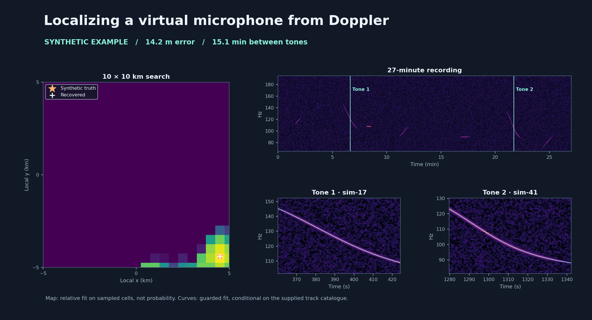

# Aircraft Audio Geolocation

Aircraft Doppler signatures can constrain where a recording was made.
This project detects descending tone ridges, compares them with flight
tracks, and can abstain when the available evidence is too weak.

## Install

Use Python 3.12 with the versions pinned for validation. Run the commands
from the repository root.

~~~sh
python3.12 -m venv .venv
. .venv/bin/activate
python -m pip install -r requirements-verified.txt
~~~

On Windows PowerShell, activate with `.venv\Scripts\Activate.ps1`.
PCM WAV works directly. Install FFmpeg on PATH for MP3, compressed WAV,
and video such as MP4.

## Analyze a local recording

The experimental `locate` command looks for two separated flyovers in a
recording you made or have permission to analyze. Supply a regional
civilian flight catalogue, an approximate UTC time for the first decoded
audio sample, and the center and receiver ellipsoid height of a flat
10 × 10 km search area.

~~~sh
python -m aircraft_doppler locate \
  --audio recording.mp4 --tracks regional.csv \
  --start-utc 2024-04-07T16:34:18Z \
  --area-center LAT LON ELLIPSOID_HEIGHT_M \
  --output runs/local
~~~

The search allows ±80 seconds around the supplied audio start. If a
video's audio starts later than its picture, use the audio start. The
decoder uses the first audio stream and channel 0 by default. Set
`--channel` to choose a different channel within that stream.

Prepare a local CSV with
`flight_id,time_s,latitude,longitude,altitude_ellipsoid_m`. Use Unix UTC
seconds and WGS84 ellipsoid metres. Split tracks at gaps over 15 seconds,
give each segment a unique `flight_id`, and use `aircraft_id` to link
segments of the same airframe. The optional `engine` column accepts
`propeller`, `jet`, or `unknown`. The command runs offline.

The output directory must be new or empty. Exit 0 reports an estimate that
passed the model's checks. Exit 2 covers abstention or invalid input.
A completed run writes `runs/local/inference.json` and
`runs/local/result-map.html`. Open the HTML in a browser to pan, zoom, and
inspect the search boundary, sampled fit scores, and selected flight paths.
An accepted run marks the receiver as supported under the model. On abstention
or a timeout, a finite lowest-residual point is shown separately as an
**estimated candidate, not accepted**, never as a receiver fix. The JSON
stores that point and its WGS84 coordinates in `diagnostic_candidate`,
or `null` if nothing was scored; `estimated_*` fields appear only after
all acceptance gates pass. On a timeout the candidate only describes
completed scoring work. A leading track hypothesis is unverified.
Add `--published-reference LAT LON` only for an intentionally published
benchmark location you want marked on the map. It is not used to fit audio
or accept a point. The map reports separation only when both points exist.

The survey and refinement layers show minimum training ridge MSE (Hz²) at
the positions the solver actually scored. Toggle each stage separately or
use **Fit finest grid** and zoom further to inspect individual samples.
With one refinement layer visible, colors adapt to the visible scores
and the cell readout keeps the original scale in Hz².
When finite scores exist, `evaluated-grid.json` saves the exact local
east, north and up coordinates, loss, stage spacing, first evaluation
spacing, and clipped scored-cell footprint for each stage with finite scores.
A reused point keeps its original score. No scores are interpolated, and
the footprint describes coverage, not location probability or uncertainty.
The HTML works offline. You can enable USGS topographic tiles in the browser
when they are available. The offline grid and result layers remain usable
without them. The HTML contains location and flight geometry, so share it only
with people who can receive those details.

`--max-seconds` sets the cooperative search budget. Decoding and input
preparation can also take time. After a timeout only positions that finished scoring are exported, including
positions within an interrupted refinement stage.

Intake was verified with synthetic PCM WAV, MP3, and MP4 with AAC. The
same synthetic flight pair and 14.2 m error were measured for each format.
The video-without-audio, single-flyover, missing-coverage, shifted-clock,
and wrong-geometry controls produced no estimate.

## Replay the synthetic benchmark

The bundled run searches eight simulated tracks with two flyovers about
15 minutes apart in a 27-minute WAV. It uses the same 10 × 10 km search
area and ±80 s recording clock prior.

~~~sh
python demo_replay.py --output runs/exact-demo
python plot_demo.py --result runs/exact-demo --output runs/exact-demo.png
~~~

| Quantity | Guarded v0.4 replay |
| --- | --- |
| Estimated position | (4,500, −4,400, 0) m in a local synthetic frame |
| Virtual track pair | sim-17 and sim-41 |
| Inferred recording offset | −66.875 s |
| Audio-derived event separation | 903.874 s |
| Distance to synthetic reference | 14.2 m |

Inference reads the [WAV](example/synthetic.wav),
[tracks](example/tracks.csv), and [candidate grid](example/candidates.csv).
The [synthetic reference](example/truth.json) is used afterward to measure
error. See the [saved result](evidence/summary.json) and
[measured traces](evidence/detected_events.json).

The detector uses the full WAV to pick ridges. The guarded fit shares one
clock offset across both passes and checks its locked predictions on
withheld ridge observations. The plot shows sampled search scores.

~~~sh
python -m aircraft_doppler.hardened --case fresh-southeast --output runs/paired-example
python -m aircraft_doppler.hardened --output runs/paired-suite
python -m unittest discover -s tests -v
~~~

Both profiles accepted 3 of 4 unseen synthetic positives with 8.1–14.2 m
error. False accepts fell from 4 of 8 to 1 of 8 across the seven primary
controls and the exact-equivalence case. In that last case, a translated
catalogue created the same acoustic pattern and still produced a false
accept. The [scorecard](evidence/scorecard.csv) records all outcomes.

## Field recordings

The [Eclipse Soundscapes 505 benchmark](benchmarks/eclipse-505-protocol.md)
documents an executable replay on licensed audio and historical tracks.
All completed arms abstained.

The earlier [Livermore adsb.lol search](https://khybolt.github.io/doppler/assets/livermore/replay-method.md)
used two public research WAVs, their exact relative start gap, a date, and
a 10 × 10 km prior. The matching pair ranked first of 17,101. The leading
candidate was 321 m from the study-reported phone position, but the verifier
abstained after the second pass failed its held-out checks.

The [Livermore portfolio map](https://khybolt.github.io/doppler/#livermore)
shows a separate assisted replay. It used the study's supplied pitch traces,
matching flight tracks, and nominal clip start times. Its best-fit candidate
was 144 m from the same reference, and this replay also abstained. Neither
distance is a verified accuracy measurement; the reference has no independent
survey bound.

The [Livermore input guide](benchmarks/livermore-inputs.md) verifies the
original WAVs and archive receipts, not the 321 m result. Recomputing that
search requires the unavailable solver and clock-screen revisions, the exact
adsb.lol-only invocation, and the report-only score hook.

[Source and data credits](RIGHTS.md)
